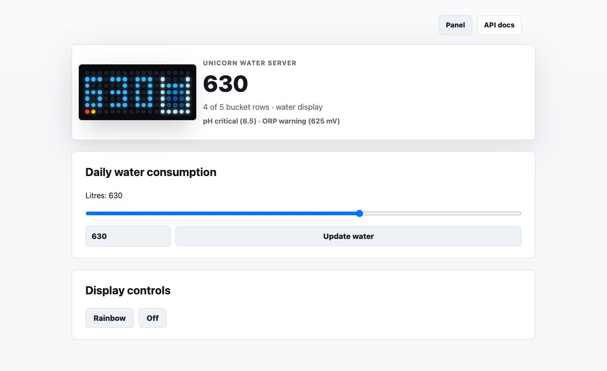

# Unicorn Water Server

Display daily domestic water consumption on a Raspberry Pi with a Pimoroni
Unicorn HAT Mini.

See the [changelog](./CHANGELOG.md) for release history and the
[security policy](./SECURITY.md) for supported versions and private reporting.



The project provides:

- A 17x7 water-consumption display designed for Unicorn HAT Mini.
- A validated HTTP API for external water-monitoring and pool-status scripts.
- A responsive React control panel with a simulated matrix preview.
- Built-in API documentation.
- A systemd service and Raspberry Pi installation scripts.
- A hardware-free dummy mode for local development and automated tests.
- A startup rainbow that confirms the Unicorn HAT Mini is working before the
  first water update arrives.

## Project Lineage

Unicorn Water Server is derived from `unicorn-solar-server`, which is derived
from `unicorn-busy-server`.

The derived project reuses the Flask/Vite structure and Unicorn hardware
wrapper, but replaces the solar battery display with a water-consumption
display and a focused API.

## Display

The server requires the Unicorn HAT Mini's native 17x7 orientation. It sets
rotation `0` and refuses to start with a different display shape so the display
cannot be silently cropped or rotated.

- The left eleven columns show up to three consumed-litre digits.
- Litres are implicit, so no unit label is rendered on the matrix.
- One empty column separates the number from the bucket.
- The right five columns show a bucket with a pale blue left side, right side,
  and base.
- The bucket top edge is open.
- Water fills the five inner rows from bottom to top.
- Each 200 litres lights one additional row: `1-200`, `201-400`,
  `401-600`, `601-800`, and `801+`.
- Values above `999` are accepted, but the matrix displays `999` with red
  digits as an overflow indicator.
- The bottom-left pixel shows pool pH status.
- The pixel immediately to its right shows pool ORP/chlorine status.
- Pool status indicators use `ok` as blue, `warning` as yellow, and `critical`
  as red.
- Darker blue sits at the bottom, brighter blue at the surface.
- Small bright pixels at the surface shift between frames to create a subtle
  ripple.

| Daily litres | Active rows |
|---:|---:|
| `0` | 0 |
| `1-200` | 1 |
| `201-400` | 2 |
| `401-600` | 3 |
| `601-800` | 4 |
| `801+` | 5 |

### Pool Chemistry Indicators

Pool chemistry is intentionally represented as a small overlay on the water
display rather than as a separate display mode. This keeps the domestic water
consumption view active while allowing hourly pool pH and ORP/chlorine updates.

The recommended classification is:

| Metric | `critical` | `warning` | `ok` |
|---|---|---|---|
| pH | `< 6.6` or `> 8.4` | `6.6-7.2` or `7.6-8.4` | `7.2-7.6` |
| ORP | `< 400` or `> 900` | `400-650` or `750-900` | `650-750` |

Boundary values are included in the less severe band. For example, pH `7.2`
and `7.6` are `ok`; ORP `650` and `750` are `ok`.

## API

### Update Water Consumption

```http
POST /api/water
Content-Type: application/json

{"liters": 30}
```

`liters` accepts any non-negative finite number. Values are rendered as
integers. Values above `999` keep the real `liters` value in the API response,
but `displayLiters` is capped at `999` and `overflow` is set to `true`; the
matrix shows red `999` digits.

### Read Status

```http
GET /api/status
```

The response includes the current litres, displayed litres, overflow state,
pool indicators, active bucket rows, hardware type, display dimensions,
rotation, display mode, and last update information.

### Update Pool Chemistry Indicators

```http
POST /api/pool
Content-Type: application/json

{
  "ph": {"status": "warning", "value": 6.9},
  "orp": {"status": "ok", "value": 697}
}
```

`status` accepts `ok`, `warning`, `critical`, or `null`. `value` is optional and
may be `null`. Sending `null` as the status clears that indicator. This endpoint
does not change `displayMode`; indicators are rendered only when the display is
in water mode.

### Discover Endpoints

```http
GET /api/
```

### Validate The Display

The server starts with this rainbow animation instead of showing an empty
display, making hardware and service startup failures easier to identify.

```http
POST /api/rainbow
Content-Type: application/json

{"brightness": 1, "speed": 0.1}
```

Both values are optional.

### Show Standby Clock

```http
GET /api/standby
```

`POST /api/standby` is also accepted. Standby shows a very dim `HH:MM` clock
 at brightness `0.05` for overnight visibility with minimal light. Repeated
standby calls are idempotent and keep the existing standby display running.
Any water update stops standby and restores the water display.

### Turn Off The Display

```http
GET /api/off
```

`POST /api/off` is also accepted. This stops any animation and turns off every
display pixel. Any water update stops the rainbow, standby, or off state and
restores the water display.

## Installation

The service name is `unicorn-water.service` and the default HTTP port is
`9002`, leaving `9000` for Unicorn Busy Server and `9001` for Unicorn Solar
Server.

The installer is self-contained for the Python runtime used by this service. It
does not depend on Pimoroni's `unicornhatmini-python/install.sh` installer and
does not create a virtual environment with `--system-site-packages`. Instead it:

- installs base system packages needed to create and build Python virtual
  environments: `python3-pip`, `python3-dev`, and `python3-venv`;
- creates an isolated virtual environment at `/home/<user>/.env` by default;
- installs this project's `requirements.txt` into that virtual environment,
  including `unicornhatmini`, `unicornhat`, `RPi.GPIO`, `gpiozero`, `spidev`,
  and the Flask server dependencies;
- writes a systemd unit that starts the server with
  `/home/<user>/.env/bin/python`;
- runs the service as the target user, `pi` by default, not as root;
- sets `PYTHONUNBUFFERED=1` in the unit for predictable service logs.

The Unicorn HAT Mini still requires SPI to be enabled on the Raspberry Pi. If
the HAT is newly installed or the OS image is fresh, enable SPI before starting
the service:

```bash
sudo raspi-config nonint do_spi 0
```

Pimoroni's
[Unicorn HAT Mini getting started guide](https://learn.pimoroni.com/article/getting-started-with-unicorn-hat-mini)
is useful for hardware setup and examples, but the Water Server deployment
should use this repository's installer so service dependencies remain isolated
from system Python package removals.

When installing from a local checkout, the intended shape is:

```bash
sudo ./install.sh --user pi --venv-dir /home/pi/.env --install-dir /home/pi/unicorn-water-server
```

After the project has been cloned on the Raspberry Pi, the same installer can
be run from the checkout:

```bash
cd /home/pi/unicorn-water-server
sudo ./install.sh --user pi --venv-dir /home/pi/.env --install-dir /home/pi/unicorn-water-server
```

### Runtime Deployment Model

The Raspberry Pi runtime directory does not have to be a Git checkout. The
installer can clone the project when it needs to create a fresh install, but an
installed service is just a working runtime tree plus a systemd unit.

For existing installations, the expected update flow is:

1. validate changes in a separate source checkout;
2. copy the validated files into the Raspberry Pi runtime directory with a
   controlled file copy tool such as `rsync` or `scp`;
3. keep a short-lived backup of any runtime file being replaced when the change
   is operationally sensitive;
4. reload systemd only if the unit file changed;
5. restart `unicorn-water.service` only when server code, dependencies, or the
   unit file changed;
6. validate `GET /api/status` and, when appropriate, post a real water update.

Do not rely on `git pull` inside the runtime directory unless you have
explicitly installed that directory as a Git checkout.

```bash
systemctl status unicorn-water.service
```

Open the control panel at:

```text
http://<raspberry-pi-ip>:9002/
```

## Home Assistant Integration

Home Assistant can monitor the running server through the built-in REST
integration and display the current matrix state in a Lovelace dashboard. See
[Home Assistant integration](./docs/home-assistant.md) for package and dashboard
YAML examples.

## Coexisting With Other Unicorn Servers

Only one service should control the Unicorn HAT Mini at a time. Water Server's
systemd unit conflicts with `busylight.service`, and its installer also stops
`unicorn-solar.service` if present.

| Project | systemd service | HTTP port |
|---|---|---:|
| Unicorn Busy Server | `busylight.service` | `9000` |
| Unicorn Solar Server | `unicorn-solar.service` | `9001` |
| Unicorn Water Server | `unicorn-water.service` | `9002` |

## Development

Create a Python environment and run the server:

```bash
python3 -m venv .venv
.venv/bin/python -m pip install flask flask-cors jsmin
.venv/bin/python server.py
```

Without compatible hardware, the wrapper automatically uses a 17x7 dummy
display. The server and control panel are available at
`http://localhost:9002/`.

To force the dummy display on a Raspberry Pi that does have the HAT attached,
set `UNICORN_FORCE_DUMMY=1`. This is useful for running backend tests without
touching the physical display.

Run the checks used by CI:

```bash
UNICORN_FORCE_DUMMY=1 \
.venv/bin/python -m unittest -v
cd frontend
npm ci
npm run build
```

The public API is intentionally limited to `/api/`, `/api/status`,
`/api/water`, `/api/pool`, `/api/rainbow`, `/api/standby`, and `/api/off`;
solar battery, tariff, and busy presence endpoints are not carried over.

This project was developed with assistance from OpenAI Codex.
